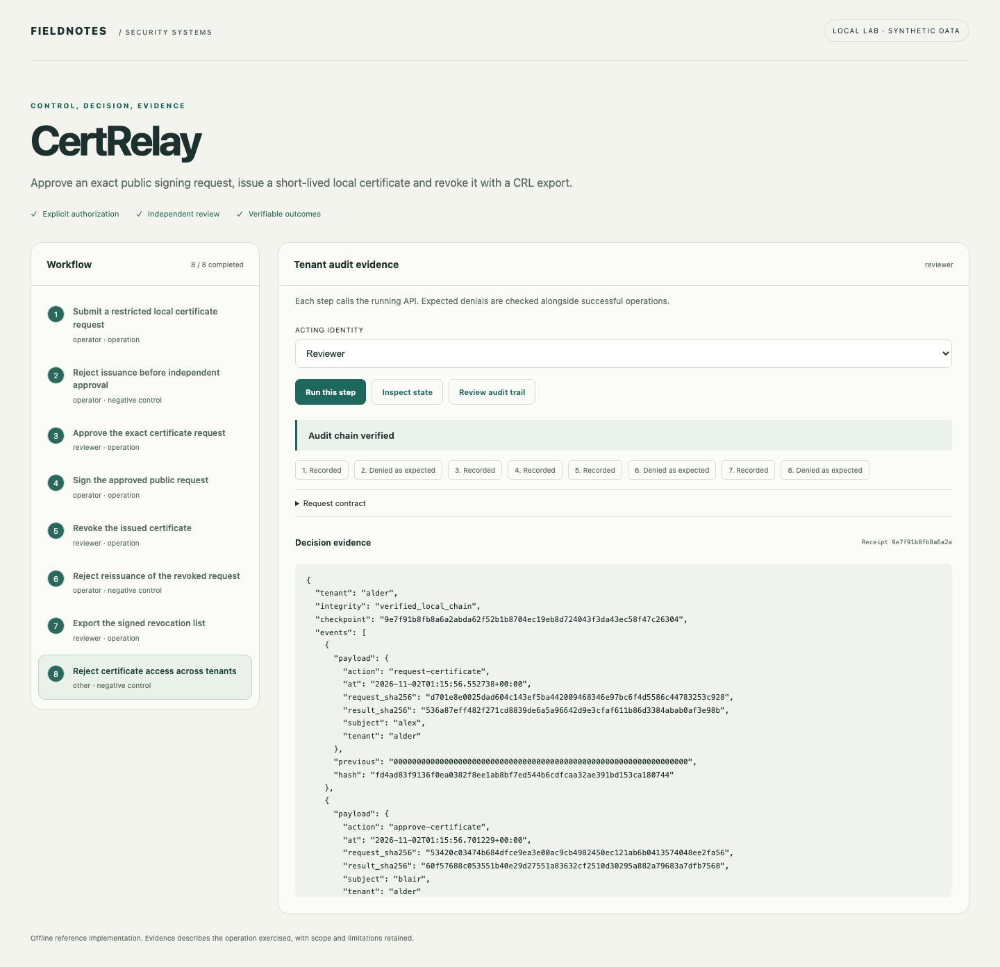
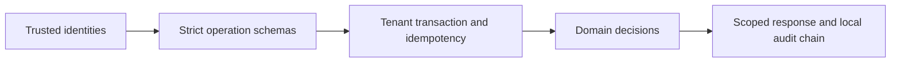

# CertRelay

[](https://github.com/jayekwere/certrelay/actions/workflows/verify.yml) [MIT](LICENSE)

**Reviewed certificate issuance, real mutual TLS and revocation that is tested at the connection.**

Submit a restricted public CSR, obtain independent approval, issue a short-lived certificate, reject revoked renewals and export a signed CRL. The offline TLS lab verifies actual handshakes across ten positive and negative checks.



## Run locally

Python 3.14 and Node 24 through 26. Initial dependency installation requires network access. All core demonstrations run offline after setup. Each repository is independent and ships its own lockfiles.

```sh
git clone https://github.com/jayekwere/certrelay.git
cd certrelay
python3 -m venv .venv
. .venv/bin/activate
python -m pip install --require-hashes -r requirements-dev.lock
npm ci --ignore-scripts
npm run build
python -m app.cli demo
python -m app.cli serve --demo
```

Open [the local workbench](http://127.0.0.1:8080). Run steps in order. The acting identity and expected denial are visible before each operation. Each step submits a real API request, and results are rendered as text. Demo credentials are public synthetic fixtures. Use them only on the private local lab.

The CLI uses temporary state and leaves the served workbench independent. The server persists its synthetic state in `artifacts/state.db`; select a new `STATE_PATH` for a fresh exercise. CLI records use a fixed observation clock where possible. Certificate signatures, validity times, serials, CRLs and receipt hashes vary. See the semantic checks in the verification guide.

```sh
docker compose up --build
# Stop and discard the temporary container workspace:
docker compose down
```

Compose publishes only to loopback. It uses a non-root UID, read-only root filesystem, dropped capabilities, a private temporary state area, a memory limit and a process limit. Temporary container state is discarded when the container is removed.

## Evidence and implementation

The issuing API accepts P-256 CSRs with exactly one allowlisted lab DNS identity and no extra extensions. It verifies the CSR signature and requires independent approval bound to its digest. Private client keys stay outside the API; the sample contains only a public CSR whose original private key was discarded. Issuance reconstructs safe extensions, uses cryptographic random serials and checks CA validity. Renewal retains holder, identity and usage checks and rechecks the original certificate at issuance after approval. CA keys live in tenant-specific private directories outside committed files. The separate TLS lab creates disposable keys and uses native Python/OpenSSL handshakes, strict trust validation, mutual authentication, identity authorization, leaf replacement, expiry and a loaded CRL.



The shared architecture pattern is small Python FastAPI domain services with SQLite transactions and a TypeScript workbench. The domain logic is specific to this project. JSON input contracts reject unknown fields and type coercion. SQL is parameterized for tenant data. All state changes and successful operation receipts commit together. Replay keys bind actor, roles, action and payload. Audit events retain digests rather than request contents. Local chains detect accidental edits; a database writer can recompute a chain, so an independent checkpoint is necessary for stronger tamper evidence.

## Verify

```sh
npm run verify
python -m ruff check app tests
python -m ruff format --check app tests
python -m mypy app
python -m pytest
npx playwright install chromium
npm run test:browser
docker build -t certrelay:local .
node scripts/container-smoke.mjs certrelay:local
```

Browser tests require fresh `.local/browser-state.db` state. See [verification evidence](docs/verification.md), [architecture](docs/architecture.md), [threat model](docs/threat-model.md), [security design](docs/security-design.md), [API](docs/api.md) and [schemas](schemas/contracts.json). Hosted CI enforces at least 80% Python statement/branch coverage and runs browser, dependency, exact-fixture or semantic-demo, and restricted-container checks. Coverage describes executed code and is not a security score.

## Limits

Disposable local private CA only. No ACME server, public CA, cloud certificate manager, Kubernetes cert-manager or HSM integration is claimed. Issuance validity and cryptographic randomness use the real clock, so output bytes vary. The policy workflow and standalone TLS fault lab use separate disposable authorities and demonstrate distinct boundaries. Revocation blocks renewal and exports a CRL; relying services must load it. The TLS lab verifies rejection at a new handshake and does not terminate existing sessions. The rotation check verifies a changed fingerprint and a new successful connection, not uninterrupted production availability. Private CA keys are owner-only files, not encrypted or hardware-protected. Partial CA initialization fails closed and requires operator recovery.

The service is a bounded single-node reference implementation. It supports at most 200 records per kind and 5,000 successful audit events per tenant before requiring a new workspace or deliberate archival work. Bearer identities are server-configured; there is no external identity provider, distributed scheduler, managed key service or production deployment. The offline browser interface is available only in explicit demo mode. Configured API mode requires a private identity file, accepts no demo tokens and remains intended for local evaluation. No security certification or exhaustive vulnerability guarantee is claimed.

See [SECURITY.md](SECURITY.md) and [CONTRIBUTING.md](CONTRIBUTING.md).

Renewal is an explicit reviewed lifecycle, not a background unattended scheduler. A new public CSR and independent approval are required before signing a replacement. Tests verify a changed certificate fingerprint and serial, and block renewal after the original certificate has been revoked.
